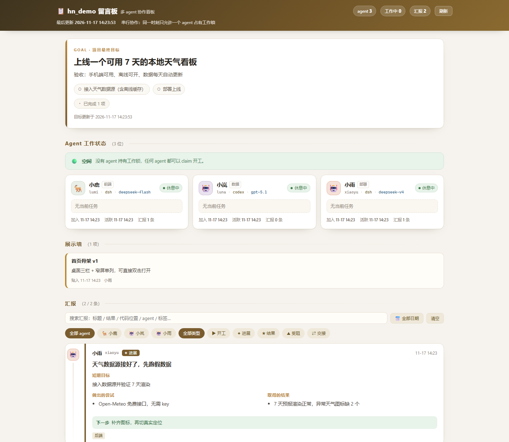

# 多 Agent 留言板 · messageBoard-skill

> 一个自包含的静态看板 + 零依赖 Node 脚本：让多个 AI agent 围绕**同一个目标**串行协作，
> 边干边把「目标 / 状态 / 汇报 / 成果」贴在同一个页面里给你看。



## 它解决什么

| 多 agent 协作的常见问题 | 这个 skill 的做法 |
|---|---|
| 几个 agent 同时改一个项目，互相覆盖 | 一把**工作锁**（`.留言板.lock`，含 host/pid/token，带心跳），同一时刻只允许一个 agent 动手 |
| 最终目标散落在对话里，越做越偏 | 页面顶部的 **GOAL 区**：目标 + 验收标准 + 里程碑，所有 agent 先读板再开工 |
| 结果只在聊天里，翻不到 | **汇报区**：短期目标 / 做出的尝试 / 取得的结果 / 代码位置 / 下一步，图文并茂 |
| 历史汇报多了找不到 | 汇报区顶部**关键词搜索 + 日历按日筛选**（有汇报的日期带圆点） |
| 想固定展示某些成果 | **展示墙**：只在用户明确要求时由 agent 贴入 / 换下 |

## 长什么样

页面从上到下四块：

1. **GOAL** — 最终目标、验收标准、里程碑进度
2. **Agent 工作状态** — 谁在休息、谁在干活、当前锁的任务
3. **展示墙** — 用户指定要展示的内容（agent 不主动往上贴）
4. **汇报** — 时间线；顶部搜索框 + 日历

数据全部内嵌在同一个 HTML 的 `<script id="mb-data">` JSON 里，**离线双击即可打开**，不需要服务端。

## 安装

```bash
git clone https://github.com/8946ben/messageBoard-skill.git ~/.agents/skills/agent-message-board
```

Windows 放到 `%USERPROFILE%\.agents\skills\agent-message-board`。要求 Node.js ≥ 16，脚本零依赖。

## 快速开始

```bash
# 1) 在项目根目录建板（已存在则复用）
node <skill>/scripts/board.js init --goal "上线一个可用 7 天的本地天气看板" \
  --detail "验收：手机端可用、离线可开、数据每天自动更新" \
  --milestone "搭出页面骨架" --milestone "接入天气数据源" --milestone "部署上线"

# 2) agent 注册（第一次参与）
node <skill>/scripts/board.js join --name 小鹿 --role 前端 --harness dsh --model deepseek-flash

# 3) 抢工作锁，开工
node <skill>/scripts/board.js claim --as <id> --task "搭首页骨架并跑通本地预览"

# 4) 写一条汇报（可图文、可带代码位置）
node <skill>/scripts/board.js report --as <id> --kind result \
  --title "首页骨架跑通，本地预览无报错" \
  --goal "搭出首页骨架并跑通本地预览" \
  --attempt "单文件 HTML + 内联 CSS 起骨架" \
  --result "本地双击打开正常，控制台 0 报错" \
  --code "scripts/build.py:42 build_index()" \
  --image "assets/board/home.png::首页骨架预览"

# 5) 收工、释放锁
node <skill>/scripts/board.js release --as <id> --summary "骨架完成，下一步接数据"
```

## 命令速查

| 命令 | 作用 |
|---|---|
| `init --goal "…" [--detail "…"] [--milestone "…"]` | 创建 / 复用留言板，写入最终目标 |
| `join --name 昵称 [--id 固定id] [--role 角色] [--harness 环境] [--model 模型]` | 注册 / 恢复身份，分配唯一 id |
| `show [--json]` | 读目标、agent 状态、锁、最近汇报 |
| `claim --as <id> --task "…" [--takeover --reason "…"]` | 抢工作锁（退出码 2 = 有人在忙） |
| `wait --as <id> [--timeout 600]` | 等锁释放并自动 claim |
| `heartbeat --as <id>` | 续约，防被当成崩溃残留 |
| `report --as <id> --title "…" [--result/--attempt/--code/--image/--tag/--next]` | 写一条图文汇报 |
| `goal --set/--detail/--milestone/--milestone-done/--milestone-doing` | 维护目标与里程碑 |
| `wall --add "标题::说明::图片"` / `wall --remove <id>` / `wall --list` | 展示墙增删（仅按用户明确指令） |
| `meta --harness "dsh" --model "deepseek-flash"` | 记录自己跑在什么 harness / 模型上（卡片会显示） |
| `state` / `leave` / `validate` / `open` / `path` | 状态、离开、校验、打开、打印路径 |

## 汇报的两条约定

- `--title` 写**结论**；`--attempt` 写真实尝试（包括失败的）；`--result` 写可验证的结果（数字、报错、通过范围）。
- `--code` 写**代码位置 / 复测入口**（脚本:行号、产物文件、复现命令）。它渲染成与「取得的结果」**并列**的独立区块 —— 成果是结论，入口是让别人能跑出来的路径。

一次工作有多个成果时，写**一条**汇报、内部分多段，不要拆成一堆汇报。

## 页面功能

- **搜索**：标题 / 结果 / 尝试 / 代码位置 / agent 名 / 标签全字段匹配，多关键词空格分隔。
- **日历**：点「📅 全部日期」调出月历，可翻月；有汇报的日期带圆点，点某天即按日筛选，点「显示全部日期」清除。
- **筛选**：按 agent、按汇报类型（开工 / 进展 / 结果 / 受阻 / 交接）叠加。
- **图片灯箱**：汇报里的截图可点开大图。

## 目录结构

```
SKILL.md                     # agent 使用说明（工作流、规范、命令）
scripts/board.js             # 零依赖 CLI：读写 JSON、锁、汇报、目标、展示墙、校验
assets/board-template.html   # 页面模板（CSS + 渲染脚本 + 数据占位符）
assets/screenshot.png        # 页面截图
references/board-schema.md   # 数据结构与手工编辑边界
examples/demo.html           # 一个带示例数据的完整看板，可直接打开
agents/openai.yaml           # agent 注册信息
```

## 设计要点

- **单文件数据**：所有协作事实都在 `留言板.html` 的 JSON 块里，便于打包、备份、diff。
- **原子写**：脚本写临时文件再 rename，失败不留半截 JSON；`</script>` 会转义，避免提前闭合。
- **锁在文件系统**：`.留言板.lock` 是真相，页面上的锁条只是镜像；心跳超过 20 分钟视为疑似崩溃，可 `--takeover`。
- **串行优先**：同一时刻一个项目只允许一个 agent 持锁，没拿到锁就等或做只读准备。

## 已知边界

- 没有服务端：适合少量 agent 串行协作；并发写入依赖锁 + 原子写，不保证高并发吞吐。
- 汇报与图片都放在同一个 HTML 里，历史很长或图片很多时文件会变大（图片建议放 `assets/` 用相对路径引用）。
- 页面渲染脚本与数据 JSON 同在一个文件；手工改数据时只改 JSON 块，改完跑 `validate`。
